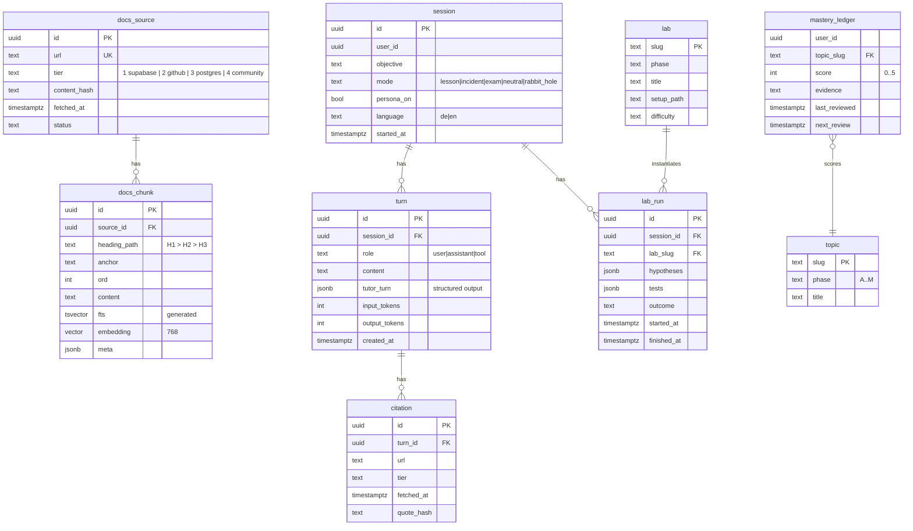

# Data model

Schema `tutor` in the local Supabase project. The authoritative DDL is
`supabase/migrations/20261021000000_tutor_core.sql`; this file explains intent.

## Search

`tutor.hybrid_search(query text, query_embedding vector, k int, source_filter text[])`
returns chunks ranked by Reciprocal Rank Fusion of

- cosine similarity on `embedding` (HNSW index, `vector_cosine_ops`), and
- `ts_rank_cd(fts, websearch_to_tsquery('english', query))` (GIN index).

Returned columns: `chunk_id, url, anchor, heading_path, content, tier, fetched_at, score`.
The tool layer builds the citation URL as `url || '#' || anchor` when an anchor exists.

## RLS

- `docs_*`, `topic`, `lab`: readable by `authenticated` and `anon` (public corpus),
  writable only by `service_role` (ingest).
- `session`, `turn`, `citation`, `lab_run`, `mastery_ledger`: `user_id = (select auth.uid())`
  for all four operations; FastAPI uses the user's JWT for these tables, not `service_role`.
- Every policy predicate has a supporting index (`user_id`), which the tutor itself uses as a teaching example.

## Lab database

A second local database `lab` (created by `supabase/seed.sql` via `dblink`/`\c` is not
possible in seed; instead `scripts/lab_db.sh` creates it with `psql` using the CLI's
connection string). Each lab in `labs/<slug>/setup.sql` creates its objects inside a
schema named after the lab, so `DROP SCHEMA <lab> CASCADE` resets one lab without
touching the others. Roles `anon`, `authenticated`, `service_role` exist in the lab DB
exactly as in a Supabase project so grant/RLS behaviour matches.
